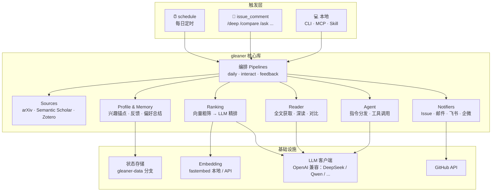
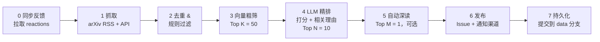
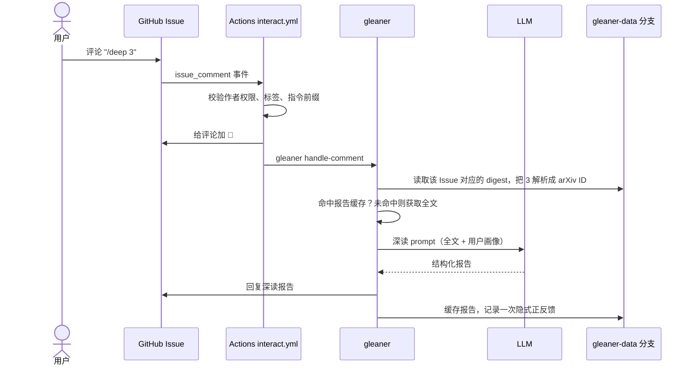

# Paper Gleaner 架构与实施方案

> 状态：草案 v0.1（2026-10-24）
>
> 本文是项目的总体设计，描述「做什么、怎么分层、按什么顺序落地」。具体实现细节在各阶段开发时再细化。

**一句话定位**：一个 fork 即用、不需要服务器的「论文追踪 Agent」。它每天从 arXiv 挑出和你研究方向相关的新论文，逐篇说明「为什么和你相关」；你可以在 GitHub Issue 里用 `/deep`、`/compare` 追问，它也会根据你的 👍/👎 不断调整推荐。

---

## 目录

1. [背景与目标](#1-背景与目标)
2. [总体架构](#2-总体架构)
3. [核心流程](#3-核心流程)
4. [存储设计](#4-存储设计)
5. [代码结构](#5-代码结构)
6. [技术选型](#6-技术选型)
7. [配置与密钥](#7-配置与密钥)
8. [GitHub Actions 设计](#8-github-actions-设计)
9. [推送渠道](#9-推送渠道)
10. [Claude Code Skill / MCP](#10-claude-code-skill--mcp)
11. [安全与稳健性](#11-安全与稳健性)
12. [成本估算](#12-成本估算)
13. [实施路线图](#13-实施路线图)
14. [用户上手流程](#14-用户上手流程)
15. [开放问题](#15-开放问题)
16. [附录：日报评论示例](#附录日报评论示例)

---

## 1. 背景与目标

### 1.1 现有方案的短板

以 zotero-arxiv-daily 为代表的现有方案，本质上是推荐算法而不是 Agent：它用嵌入向量计算新论文和 Zotero 文献库的加权相似度，再让 LLM 生成一句话摘要。它的局限有三点：

- 兴趣来源必须是 Zotero 文献库；
- 不会深度阅读论文；
- 不能交互，也不会根据反馈学习你的兴趣。

### 1.2 差异化

| 能力 | 现有方案 | Paper Gleaner |
| --- | --- | --- |
| 兴趣来源 | 必须用 Zotero | 写一段研究方向描述即可，Zotero 可选 |
| 筛选方式 | 嵌入相似度 | 嵌入粗筛 + LLM 精排，并说明「为什么和你相关」 |
| 深度阅读 | 无 | Agent 读全文，提取方法、实验、代码链接，对比相关工作 |
| 交互 | 无 | 在 GitHub Issue 里评论 `/deep`、`/compare` 触发 Agent 回复 |
| 记忆 | 无 | 根据 👍/👎 自动更新兴趣画像，存成仓库文件 |
| 生态 | 仅邮件 | 邮件、飞书、企业微信推送，外加 Skill/MCP，在 Claude Code 里也能问 |
| 成本 | — | 适配 DeepSeek、Qwen 等便宜的国产模型 |

**核心设计：用 GitHub Issues 做交互界面。** 每天的推送自动发成一个 Issue，用户在下面评论就会触发 Action 运行 Agent 并回复。整个过程不需要服务器，任何人都能零成本使用。

### 1.3 设计目标

| # | 目标 | 验收标准 |
| --- | --- | --- |
| G1 | fork 即用 | fork 后配置 1 个 Secret、写一段兴趣描述、启用 Actions，10 分钟内收到第一份日报 |
| G2 | 零服务器、低成本 | 全部运行在 GitHub Actions 上；默认使用国产低价模型，每天 LLM 费用在 ¥0.5 以内 |
| G3 | 推荐可解释 | 每篇推荐都写明匹配了用户的哪一个兴趣点、为什么 |
| G4 | 可交互 | 评论指令后 3 分钟内收到回复（主要耗时在 Actions 冷启动） |
| G5 | 会学习、可审计 | 反馈和学到的偏好都以文件形式存在 git 中，可以查看、手改、回滚 |
| G6 | 多端触达 | 邮件、飞书、企业微信推送；在 Claude Code 中通过 Skill/MCP 使用 |

### 1.4 非目标（v1）

- 不做 Web UI，不维护任何服务器；
- 不覆盖全部论文来源：v1 只做 arXiv，但预留 Source 接口；
- 不做多用户：一个 fork 对应一个用户；
- 不替代文献管理工具：Zotero 只作为可选的兴趣输入。

---

## 2. 总体架构

### 2.1 分层



### 2.2 架构原则

1. **一套核心库，多个入口。** 所有能力都实现在 `gleaner` Python 包里，通过一个 CLI 暴露。GitHub Actions、MCP Server、Claude Code Skill 都只是调用这个 CLI 或核心库的不同入口，保证三端行为一致。
2. **流水线优先，Agent 兜底。** 高频、格式固定的任务（日报、`/deep`、`/compare`）用确定性的流水线实现，输出稳定、成本可控；只有开放式问题（`/ask`）才交给带工具调用的 Agent 循环。
3. **仓库即数据库。** 用户画像、反馈、历史、深读缓存都以文本文件存放在 git 中，不依赖任何外部数据库。
4. **LLM 供应商无关。** 只依赖 OpenAI 兼容接口，改 `base_url` 和模型名就能切换 DeepSeek、Qwen、Kimi、GLM、OpenAI 等。
5. **优雅降级。** 任何外部依赖（LLM、Semantic Scholar、某个推送渠道）失败时，主流程照常完成，并在输出中注明降级。

---

## 3. 核心流程

### 3.1 每日推送流水线



| 步骤 | 说明 |
| --- | --- |
| 0. 同步反馈 | 扫描最近 7 天日报 Issue 中每篇论文评论的 reactions，增量写入反馈记录（原因见 [3.4](#34-反馈与记忆)） |
| 1. 抓取 | 用 arXiv RSS 获取所关注分类当天公告的论文列表（区分 new / cross-list / replace），再用 arXiv API 批量补全元数据。没有新公告（周末、节假日）时直接结束，不发 Issue |
| 2. 去重与规则过滤 | 排除已处理过的 ID；默认排除 replace 版本；支持关键词白名单（必推）和黑名单（必不推） |
| 3. 向量粗筛 | 计算每篇论文与「兴趣锚点」的综合相似度，保留 Top K（默认 50），详见 3.1.1 |
| 4. LLM 精排 | LLM 分批打分并生成相关理由，保留分数不低于阈值的 Top N（默认 10），详见 3.1.2 |
| 5. 自动深读 | 对分数最高的 M 篇（默认 1，可设为 0）预先生成深读报告，附在对应评论里 |
| 6. 发布 | 创建当日 Issue：正文是总览，每篇论文单独一条评论（方便逐篇点 👍/👎）；同时向已启用的渠道发送摘要和 Issue 链接 |
| 7. 持久化 | 写入当日 digest（全部 Top K 候选、分数、理由、Issue 与评论 ID 的映射）、已处理 ID、运行统计，提交到 `gleaner-data` 分支 |

#### 3.1.1 兴趣锚点与粗筛打分

粗筛的对比对象是一组「兴趣锚点」向量，来源有四类：

| 锚点 | 来源 | 说明 |
| --- | --- | --- |
| A1 兴趣描述 | `profile/interests.md`（用户手写） | 首次运行时由 LLM 拆解成若干子方向，每个子方向生成一段英文检索描述。结果按源文件 hash 缓存，描述改动后自动重建。这一步同时解决了「中文描述 vs 英文论文」的跨语言匹配问题 |
| A2 正反馈论文 | 👍、`/like`、`/deep` 过的论文 | 用标题 + 摘要生成向量 |
| A3 负反馈论文 | 👎、`/dislike` 过的论文，`/mute` 的主题 | 作为惩罚项 |
| A4 Zotero 文献库 | 可选 | 兼容 zotero-arxiv-daily 的用法 |

综合分数（权重在配置中可调）：

```text
score(p) = w_interest · max_i cos(p, A1_i)
         + w_pos      · mean_top3 cos(p, A2)      # 按时间衰减加权，半衰期默认 90 天
         + w_zotero   · mean_top3 cos(p, A4)
         − w_neg      · max_j cos(p, A3_j)
```

冷启动时只有 A1；反馈越多，A2/A3 的影响越大。

#### 3.1.2 LLM 精排

- **输入**：用户画像（`interests.md` + 学到的偏好 `learned_preferences.md`）+ 一批论文（每批 10 篇，包含标题、摘要、分类）。
- **输出**：结构化 JSON，用 pydantic 校验：

```json
{
  "results": [
    {
      "id": "2410.12345",
      "score": 8,
      "matched_interests": ["长上下文推理"],
      "reason": "提出了 KV cache 分层压缩方法，与你关注的长上下文推理效率直接相关，并在 128K 长度上做了评测。",
      "tldr": "一句话中文摘要",
      "tags": ["efficiency", "long-context"]
    }
  ]
}
```

- **约束**：`score` 采用 0–10 分并给出明确的打分标准；`reason` 必须引用一个具体兴趣点，不允许写成泛泛的「与你的研究相关」。
- **容错**：JSON 解析失败时重试一次；仍然失败就退回按向量分数排序，日报照常发出，并在正文中注明。

### 3.2 交互流程（Issue 评论）



**指令集**

| 指令 | 示例 | 行为 | 实现方式 |
| --- | --- | --- | --- |
| `/deep <ref>` | `/deep 3`、`/deep 2410.12345` | 深读全文，输出结构化报告 | 固定流水线 |
| `/compare <ref> <ref> ...` | `/compare 3 5` | 多篇论文横向对比（问题、方法、实验设置、结果、代码） | 固定流水线 |
| `/compare <ref>` | `/compare 3` | 单篇论文与其相关工作对比（来自 Semantic Scholar 和你的历史） | 固定流水线 |
| `/ask <问题>` | `/ask 今天哪篇的方法能用到我的检索增强实验里？` | 自由问答 | 工具调用 Agent |
| `/more [n]` | `/more 5` | 展开当天未入选的候选（直接读精排结果，不再调用 LLM） | 读缓存 |
| `/like <ref> [原因]` | `/like 3 有开源代码，方法简单` | 显式正反馈，带原因的反馈价值最高 | 写反馈 |
| `/dislike <ref> [原因]` | `/dislike 7 纯 benchmark` | 显式负反馈 | 写反馈 |
| `/mute <主题>` | `/mute 医学影像` | 屏蔽某个主题，作为负向锚点 | 写画像 |
| `/help` | | 列出指令 | — |

`<ref>` 可以是当天 Issue 中的序号、arXiv ID 或 arXiv 链接。序号按「当前 Issue 对应的那一天」解析，所以在旧日报下评论同样有效。

**为什么 `/deep`、`/compare` 用流水线而 `/ask` 用 Agent**：前两者使用频率高、需要稳定的报告格式和可预期的成本，用固定步骤实现最合适；`/ask` 的问题是开放的，需要模型自己决定查什么，因此使用工具调用循环，最多 8 步并设置 token 上限。

**Agent 工具（全部只读）**

| 工具 | 作用 |
| --- | --- |
| `get_digest(date)` | 获取某天的日报与候选 |
| `get_paper(ref)` | 获取论文元数据 |
| `read_fulltext(arxiv_id, sections?)` | 获取全文或指定章节 |
| `search_arxiv(query)` | 检索 arXiv |
| `related_works(arxiv_id)` | 通过 Semantic Scholar 获取引用、被引和推荐论文 |
| `get_profile()` | 读取兴趣描述与学到的偏好 |
| `search_history(query)` | 在推送过、点赞过的历史论文中检索 |

Agent 没有任何写操作工具。发回复、写反馈这类副作用都由编排代码完成，不由 LLM 决定，从而限制提示注入的影响范围（见 [11](#11-安全与稳健性)）。

### 3.3 深读

**全文获取（按优先级）**

1. arXiv HTML 版（`arxiv.org/html/<id>`）：结构清晰，保留章节；
2. PDF：用 PyMuPDF 抽取文本；
3. 都失败时退化为基于摘要的分析，并在回复中注明。

**处理步骤**

1. 切分章节，按优先级保留：Abstract、Introduction、Method、Experiments、Conclusion 优先；References 和大部分 Appendix 跳过；
2. 截断到 token 预算（默认约 30k）。v1 单次调用；遇到超长论文再考虑按章节 map-reduce；
3. 代码链接：从正文正则提取 GitHub、GitLab、Hugging Face 链接，并查询 Hugging Face Papers 上关联的代码仓库；
4. 相关工作：通过 Semantic Scholar API 获取参考文献和推荐论文，再与用户历史（推送过、点赞过的论文）做向量近邻检索。

**报告模板**

- 一句话总结
- 解决什么问题、动机是什么
- 方法要点
- 实验：数据集、基线、关键结果（表格）、消融
- 代码与资源
- 与你研究的关系（结合用户画像）
- 局限与值得追问的点
- 相关工作对比（表格）

**缓存**：报告保存在 data 分支的 `reports/<arxiv_id>.md`，重复执行 `/deep` 直接返回缓存；`/deep 3 --force` 强制重新生成。

### 3.4 反馈与记忆

**反馈信号**

| 信号 | 来源 | 权重 |
| --- | --- | --- |
| 👍 / 👎 reaction | 论文评论上的表情，下一次日报前同步 | ±1 |
| `/like`、`/dislike`（可带原因） | 即时写入 | ±2 |
| `/deep`、`/compare` | 隐式正反馈 | +0.5 |
| `/mute <主题>` | 即时写入 | 负向锚点 |
| 没有任何反应 | — | 0，不作为负例 |

> **注意：GitHub 的 reaction 不会触发 Actions 事件。** 因此 reaction 采用「拉取」方式：每日任务开始时扫描最近 7 天的日报评论，读取 reactions 并增量写入。显式指令（`/like` 等）则会立即生效。

**两层记忆**

1. **向量层（自动、快速）**：反馈论文的向量直接作为正/负锚点参与粗筛打分（见 3.1.1），每天生效。
2. **语义层（较慢、人可读）**：每周一次，或新增反馈达到 N 条时，由 LLM 把反馈记录及其原因总结成 `learned_preferences.md`，例如「偏好有开源代码的工作」「对纯 benchmark 论文兴趣低」。这份文件会注入精排 prompt。总结时把当前文件一并作为输入，要求增量修改，而不是每次重写。

**边界**：用户手写的 `interests.md` 优先级最高，LLM 永远不改动它，只写 `learned_preferences.md`。用户可以直接编辑或删除其中的条目；由于所有记忆都在 git 中，「撤销一次学习」就是一次 `git revert`。

---

## 4. 存储设计

状态分两处存放：

| 位置 | 内容 | 谁来写 |
| --- | --- | --- |
| `main` 分支 | 代码、`config.yaml`、`profile/interests.md` | 用户 |
| `gleaner-data` 孤儿分支 | 反馈、历史、缓存、学到的偏好 | Actions 机器人 |

机器写入的状态单独放在一个孤儿分支上，好处有两点：`main` 的提交历史不会被每天的自动提交淹没；用户 fork 后从上游同步代码时也不会产生冲突。

同理，上游仓库只提供 `config.example.yaml` 和 `profile/interests.example.md`，不包含 `config.yaml` 和 `profile/interests.md`。用户在自己的 fork 中创建这两个文件，以后同步上游时不会冲突。

**`gleaner-data` 分支布局**

```text
gleaner-data/
├── .gitattributes                # *.jsonl merge=union，并发追加时自动合并
├── profile/
│   ├── anchors.json              # 兴趣描述拆解出的子方向和英文检索描述（含源文件 hash）
│   ├── learned_preferences.md    # LLM 总结的偏好（用户可编辑）
│   └── muted.json                # /mute 的主题
├── feedback/
│   └── 2026-10.jsonl             # 按月分片，只追加
├── history/
│   ├── seen.jsonl                # 已处理的 arXiv ID，用于去重
│   └── digests/
│       └── 2026-10-24.json       # 当日 Top K 候选、分数、理由、Issue 与评论 ID 映射
├── reports/
│   └── 2410.12345.md             # 深读报告缓存
└── stats/
    └── 2026-10.jsonl             # 每次运行的 token 用量、耗时、数量
```

- **向量不入库**：模型权重和近期论文向量用 `actions/cache` 缓存，丢失后可以重算。反馈记录本身保存标题和摘要，反馈论文的向量（通常只有几百条）每次重算的成本可以忽略。
- **并发写入**：每次写入前 `git pull --rebase`，失败重试。`.jsonl` 文件配置 `merge=union`，两个任务同时追加同一文件时会自动合并，不会产生冲突。

**核心数据模型（示意）**

```python
class Paper(BaseModel):
    id: str                  # arXiv ID，如 "2410.12345"
    title: str
    abstract: str
    authors: list[str]
    categories: list[str]
    published: datetime
    url: str
    pdf_url: str

class ScoredPaper(Paper):
    coarse_score: float
    llm_score: int | None
    matched_interests: list[str]
    reason: str
    tldr: str
    tags: list[str]

class Feedback(BaseModel):
    paper_id: str
    title: str
    abstract: str
    signal: Literal["up", "down", "like", "dislike", "deep", "compare"]
    weight: float
    note: str | None         # /like 或 /dislike 附带的原因
    source: Literal["reaction", "command"]
    created_at: datetime
```

---

## 5. 代码结构

```text
paper-gleaner/
├── .github/workflows/
│   ├── daily.yml                 # 定时：每日推送
│   ├── interact.yml              # issue_comment：指令交互
│   ├── weekly.yml                # 定时：偏好总结（可选周报）
│   └── ci.yml                    # lint + test
├── .claude/skills/paper-gleaner/
│   └── SKILL.md                  # Claude Code Skill
├── gleaner/
│   ├── cli.py                    # typer CLI：daily / handle-comment / deep / compare / sync-feedback / summarize
│   ├── config.py                 # 读取 config.yaml 与环境变量，pydantic 校验
│   ├── models.py                 # Paper / ScoredPaper / Feedback / Digest / DeepReport
│   ├── pipelines/
│   │   ├── daily.py
│   │   ├── interact.py
│   │   └── feedback.py
│   ├── sources/
│   │   ├── base.py               # Source 协议，方便以后接入 OpenReview 等
│   │   ├── arxiv.py
│   │   ├── semantic_scholar.py
│   │   └── zotero.py
│   ├── profile/
│   │   ├── anchors.py            # 兴趣描述 → 子方向 / 检索描述
│   │   └── memory.py             # 反馈读写、偏好总结
│   ├── ranking/
│   │   ├── embedder.py           # fastembed 本地 / OpenAI 兼容 embeddings API
│   │   ├── coarse.py             # 向量粗筛
│   │   └── rerank.py             # LLM 精排 + 理由
│   ├── reader/
│   │   ├── fulltext.py           # arXiv HTML / PDF 获取与解析
│   │   ├── deep_read.py
│   │   └── compare.py
│   ├── agent/
│   │   ├── commands.py           # 指令解析与分发
│   │   ├── tools.py              # Agent 工具（只读）
│   │   └── loop.py               # /ask 的工具调用循环
│   ├── llm/
│   │   ├── client.py             # OpenAI 兼容客户端、重试、token 统计与预算
│   │   └── prompts/              # prompt 模板
│   ├── notify/
│   │   ├── base.py               # Notifier 接口
│   │   ├── github_issue.py
│   │   ├── email.py
│   │   ├── feishu.py
│   │   └── wecom.py
│   ├── store/
│   │   └── data_branch.py        # 读写 gleaner-data 分支
│   └── render/templates/         # 日报 / 深读 / 对比的 Markdown 模板
├── integrations/mcp_server/
│   └── server.py                 # MCP Server（stdio）
├── profile/
│   └── interests.example.md
├── config.example.yaml
├── tests/
├── docs/
│   └── architecture.md           # 本文
└── pyproject.toml
```

---

## 6. 技术选型

| 领域 | 选择 | 理由 |
| --- | --- | --- |
| 语言 | Python 3.11+ | 论文处理与 LLM 生态最完善 |
| 依赖管理 | uv | 在 Actions 中安装快，锁文件可复现 |
| arXiv 抓取 | arXiv RSS + arXiv API（httpx + feedparser） | RSS 给出当天公告列表，API 补全元数据；遵守 API 请求间隔 3 秒的要求 |
| 嵌入 | fastembed（ONNX）为默认，可切换到 OpenAI 兼容 embeddings API | 不依赖 PyTorch，安装体积小，CPU 推理足够快 |
| 默认嵌入模型 | `BAAI/bge-small-en-v1.5` | 兴趣锚点已由 LLM 转成英文，英文小模型即可；多语言模型作为可选项 |
| LLM | `openai` SDK + 自定义 `base_url` | 一套代码适配 DeepSeek、Qwen、Kimi、GLM、OpenAI 等 |
| 结构化输出 | pydantic + JSON mode | 校验与重试 |
| PDF / HTML 解析 | PyMuPDF / selectolax | 速度快、依赖少 |
| GitHub 交互 | PyGithub | Issue、评论、reaction 的读写 |
| CLI | typer | |
| 模板 | Jinja2 | 日报、报告、通知消息的渲染 |
| MCP | 官方 `mcp` Python SDK | |
| 测试 | pytest + respx | 用录制的响应 mock HTTP，LLM 调用全部打桩 |

**模型分级**：便宜的模型做量大的活，强一些的模型做需要深度理解的活。

| 档位 | 用途 | 示例（以服务商当前模型名为准） |
| --- | --- | --- |
| `fast` | 兴趣拆解、精排、偏好总结 | `deepseek-chat`、`qwen-plus` |
| `deep` | 深读、对比、`/ask` | `deepseek-reasoner`、`qwen-max` |

---

## 7. 配置与密钥

**`config.example.yaml`（示意）**

```yaml
language: zh                       # 输出语言
timezone: Asia/Shanghai

sources:
  arxiv:
    categories: [cs.CL, cs.LG, cs.AI]
    include_cross_list: true
    include_replace: false

profile:
  interests_file: profile/interests.md
  zotero:
    enabled: false                 # 启用时需要 ZOTERO_ID / ZOTERO_KEY

filters:
  include_keywords: []             # 命中即进入精排
  exclude_keywords: []             # 命中即排除

ranking:
  coarse_top_k: 50
  final_top_n: 10
  min_score: 6                     # LLM 分数低于此值不推送
  weights: {interest: 1.0, positive: 0.6, zotero: 0.5, negative: 0.8}
  feedback_half_life_days: 90
  embedding:
    provider: local                # local | api
    model: BAAI/bge-small-en-v1.5

deep_read:
  auto_top_m: 1                    # 日报中自动深读的篇数，0 表示关闭
  max_input_tokens: 30000

llm:
  base_url: https://api.deepseek.com
  models:
    fast: deepseek-chat
    deep: deepseek-reasoner
  daily_token_budget: 500000       # 超出后自动降级

notify:
  github_issue:
    enabled: true
    per_paper_comment: true        # 每篇论文一条评论，便于逐篇反馈
    close_after_days: 7            # 关闭旧日报（关闭后仍可评论交互）
  email:  {enabled: false}
  feishu: {enabled: false}
  wecom:  {enabled: false}
```

**GitHub Secrets**

| Secret | 是否必需 | 说明 |
| --- | --- | --- |
| `LLM_API_KEY` | ✅ | LLM 服务的 API Key |
| `LLM_BASE_URL` | 可选 | 覆盖配置文件中的 `base_url` |
| `SMTP_HOST` / `SMTP_PORT` / `SMTP_USER` / `SMTP_PASSWORD` / `EMAIL_TO` | 启用邮件时 | |
| `FEISHU_WEBHOOK` / `FEISHU_SECRET` | 启用飞书时 | 自定义机器人地址与签名密钥 |
| `WECOM_WEBHOOK` | 启用企业微信时 | 群机器人地址 |
| `ZOTERO_ID` / `ZOTERO_KEY` | 启用 Zotero 时 | |
| `S2_API_KEY` | 可选 | 提高 Semantic Scholar 的请求限额 |

`GITHUB_TOKEN` 由 Actions 自动提供，不需要用户配置。

---

## 8. GitHub Actions 设计

### 8.1 `daily.yml`

```yaml
on:
  schedule:
    # arXiv 在美东时间周日至周四 20:00 公告，约为 UTC 周一至周五 00:00–01:00。
    # 主任务留出余量；第二个时间点是兜底，当天 Issue 已存在时直接跳过。
    - cron: "30 1 * * 1-5"   # 北京时间 09:30
    - cron: "30 3 * * 1-5"   # 北京时间 11:30（兜底）
  workflow_dispatch:
    inputs:
      force: {type: boolean, default: false}

permissions:
  contents: write              # 写 gleaner-data 分支
  issues: write                # 创建日报 Issue 与评论

concurrency:
  group: gleaner-daily
  cancel-in-progress: false
```

- 使用 `actions/cache` 缓存 uv 依赖和嵌入模型权重；
- 运行结束后把统计（抓取数、粗筛数、推送数、token 用量、耗时）写入 `$GITHUB_STEP_SUMMARY`；
- 幂等：当日 Issue 已存在时直接跳过，除非手动触发并设置 `force`。

### 8.2 `interact.yml`

```yaml
on:
  issue_comment:
    types: [created]

permissions:
  contents: write
  issues: write

jobs:
  handle:
    if: >-
      !github.event.issue.pull_request &&
      startsWith(github.event.comment.body, '/') &&
      contains(fromJSON('["OWNER","MEMBER","COLLABORATOR"]'), github.event.comment.author_association) &&
      contains(github.event.issue.labels.*.name, 'gleaner')
```

- **只响应仓库所有者和协作者**：公开仓库任何人都能评论，不加限制会被他人消耗你的 API 额度；
- **不会自我循环**：使用 `GITHUB_TOKEN` 发出的评论不会再次触发 workflow；
- **不使用 `concurrency` 分组**：GitHub 的并发组只保留一个排队中的任务，用户连续发几条指令时中间的会被取消。交互任务写入的都是只追加的数据，靠 rebase 重试加 `merge=union` 就能处理并发；
- 收到指令后先给评论加 👀，完成后加 🚀；出错时回复简短的错误信息和 `/help` 提示。

### 8.3 `weekly.yml`

每周运行一次：把近期反馈总结进 `learned_preferences.md`；可选生成一份周报 Issue（本周高分论文和兴趣变化）。

---

## 9. 推送渠道

所有渠道实现统一的 `Notifier.send(digest)` 接口。各渠道相互独立，某个渠道失败不影响其它渠道。**交互统一在 GitHub Issue 中进行**，其它渠道只发摘要和 Issue 链接。

| 渠道 | 形式 | 说明 |
| --- | --- | --- |
| GitHub Issue（主界面） | 标题如 `📚 Paper Gleaner · 2026-10-24 · 10 篇`，带 `gleaner`、`daily` 标签 | 正文：今日概览（LLM 用三句话总结趋势）+ 目录表（序号、标题、分数、匹配兴趣）+ 指令速查；每篇论文一条评论（示例见[附录](#附录日报评论示例)） |
| 邮件 | HTML 简版 | 标题、相关理由、TL;DR、Issue 链接；SMTP 支持 QQ、163、Gmail 等邮箱的授权码 |
| 飞书 | 自定义机器人 + 签名校验 | 消息卡片列出论文，附「去 Issue 讨论」按钮 |
| 企业微信 | 群机器人 markdown 消息 | 受消息长度限制，只发 Top 5 摘要和链接 |

---

## 10. Claude Code Skill / MCP

两种集成方式共用核心库，适合不同的使用习惯：

- **MCP Server**（`integrations/mcp_server/`）：stdio 模式，本地运行。读取本地 clone 的 data 分支，或通过 GitHub API 读取远端数据。提供的工具：
  - `get_digest(date)`：查看某天的推送
  - `search_history(query)`：在历史推送和点赞过的论文中检索
  - `deep_read(arxiv_id)`：深读（优先返回缓存）
  - `compare(ids)`：对比
  - `give_feedback(arxiv_id, signal, note?)`：反馈
  - `get_profile()`：查看兴趣画像

  注册方式示例：`claude mcp add paper-gleaner -- uv run gleaner-mcp`

- **Skill**（`.claude/skills/paper-gleaner/SKILL.md`）：告诉 Claude Code 在什么场景下、如何调用 `gleaner` CLI，例如「看看今天推了什么」「深读 2410.12345，再结合我当前的代码库想想怎么用」。不需要额外的服务进程。

---

## 11. 安全与稳健性

| 风险 | 对策 |
| --- | --- |
| 他人评论消耗 API 额度 | 只响应 OWNER / MEMBER / COLLABORATOR 的评论 |
| 权限过大 | workflow 只申请 `contents: write` 和 `issues: write`；Secrets 只注入到需要的 step |
| 提示注入（论文正文、评论内容） | 外部内容一律视为数据，在 prompt 中用分隔符包裹；Agent 工具全部只读；发评论、写反馈等副作用由编排代码执行，不由 LLM 决定 |
| 成本失控 | 每日 token 预算 `daily_token_budget`，超出后降级（跳过自动深读，`/ask` 暂停服务）；单条指令有 token 上限；`/ask` 最多 8 步 |
| 外部 API 限流 | arXiv API 请求间隔 3 秒；Semantic Scholar 无 key 时共享限额，失败则跳过相关工作部分 |
| LLM 输出格式错误 | pydantic 校验，失败重试一次，再失败就降级到向量排序 |
| 重复推送 | 按日期和标签查找当日 Issue，已存在则跳过 |
| 评论超长 | GitHub 评论上限为 65536 字符，超长报告拆成多条 |
| 定时任务延迟 | GitHub cron 高峰期可能延迟，用兜底时间点和幂等检查保证当天必发且只发一次 |
| 定时任务被停用 | 公开仓库长期无活动时 GitHub 会自动停用定时 workflow，需要在 README 中提示用户，并评估保活方案 |
| 日志泄露 | 默认不在日志中打印 prompt 全文和 Secrets，调试模式下才输出 prompt |

---

## 12. 成本估算

以关注 3 个分类、每天新论文约 600 篇为例：

| 环节 | 频率 | 估算 token |
| --- | --- | --- |
| 兴趣拆解 | 仅在兴趣描述改动时 | 约 2k |
| 向量粗筛 | 每天 | 0（本地 CPU 推理，约 1–2 分钟） |
| LLM 精排 | 每天，50 篇分 5 批 | 输入约 30k，输出约 6k |
| 自动深读 | 每天 1 篇 | 输入约 30k，输出约 3k |
| `/deep` 交互 | 每次 | 输入约 30k，输出约 3k（命中缓存则为 0） |
| 偏好总结 | 每周 | 约 10k |

不算交互的话，每天约 70k token。按国产模型每百万 token 几元人民币的价格量级，每天约 ¥0.1–0.5（以实际价格为准）。

GitHub Actions：公开仓库使用标准 runner 免费；私有仓库每次运行约 3–5 分钟，每月约 100–150 分钟，在免费额度之内。

---

## 13. 实施路线图

| 阶段 | 内容 | 交付与验收 |
| --- | --- | --- |
| **Phase 0 骨架**（约 2–3 天） | pyproject 与 uv、配置加载与校验、LLM 客户端（重试与用量统计）、CLI 骨架、`ci.yml` | `gleaner daily --dry-run` 能把抓到的论文打印到终端 |
| **Phase 1 MVP 日报**（约 1 周） | arXiv 抓取与去重；兴趣锚点拆解；本地嵌入粗筛；LLM 精排与相关理由；Issue 发布（每篇一条评论）；data 分支存储；`daily.yml` | fork 后配置 Secret 和兴趣描述，手动触发即可收到日报 Issue |
| **Phase 2 交互与深读**（约 1 周） | `interact.yml` 与指令解析；`/deep`（HTML/PDF 获取、代码链接、报告缓存）；`/compare`（多篇对比、单篇与相关工作对比）；`/more`、`/help` | 在日报 Issue 下评论 `/deep 1`，3 分钟内收到报告 |
| **Phase 3 反馈记忆**（约 1 周） | reaction 同步；`/like`、`/dislike`、`/mute`；反馈锚点参与粗筛；`weekly.yml` 偏好总结 | 连续反馈一周后，`learned_preferences.md` 内容合理，推荐结果有可观察的变化 |
| **Phase 4 多渠道与生态**（约 1 周） | 邮件、飞书、企业微信；`/ask` Agent；MCP Server；Claude Code Skill；Zotero 可选输入 | 各渠道都能收到推送；在 Claude Code 中可以查询当天推送 |
| **Phase 5 打磨与传播** | 缺少配置时自动创建引导 Issue；完善 README 和截图；建立 Demo 仓库；用一小份人工标注集评估精排 precision@10，据此调整权重和 prompt | 新用户按 README 能在 10 分钟内跑通 |

Phase 1 完成后项目就已经比现有方案好用（可解释的推荐 + 不依赖 Zotero）；Phase 2 带来最主要的差异化（交互式深读）。

---

## 14. 用户上手流程

目标体验：

1. Fork 本仓库；
2. 在 Settings → General 中启用 Issues（fork 默认关闭）；
3. 在 Settings → Secrets and variables → Actions 中添加 `LLM_API_KEY`（可选 `LLM_BASE_URL`）；
4. 把 `config.example.yaml` 复制为 `config.yaml`，把 `profile/interests.example.md` 复制为 `profile/interests.md`，用自然语言写一段研究方向；
5. 在 Actions 页面启用 workflows（fork 默认禁用），手动运行一次 Daily，几分钟后收到第一份日报 Issue。

如果缺少必要配置，workflow 会自动创建一个「👋 欢迎使用 Paper Gleaner」Issue，列出尚未完成的步骤。

`profile/interests.example.md` 示例：

```markdown
我是 NLP 方向的博士生，主要研究：
- 大模型的长上下文推理，尤其是 KV cache 压缩和高效注意力；
- 检索增强生成（RAG）在科学文献问答上的应用；
- 对有开源代码、能在单卡上复现的工作更感兴趣。
不太关心：纯多模态、语音、医学影像。
```

---

## 15. 开放问题

| 问题 | 当前倾向 |
| --- | --- |
| 每篇论文一条评论，还是全部写在 Issue 正文里？ | 默认每篇一条评论（支持逐篇反馈），代价是通知较多；做成可配置项 |
| 机器状态放 `gleaner-data` 分支还是 `main`？ | 倾向 data 分支，需要验证对用户是否足够直观 |
| 默认嵌入模型：英文小模型 + LLM 翻译兴趣，还是直接用多语言模型？ | 需要实测召回率和 Actions 耗时后再定 |
| 日报里是否默认自动深读？ | 默认 1 篇，在成本和体验之间折中 |
| 是否支持 arXiv 以外的来源（OpenReview、ACL Anthology、bioRxiv）？ | Source 接口预留，v2 再考虑 |
| `/ask` 是否需要跨天的对话上下文？ | v1 只用当前 Issue 内的评论作为上下文 |

---

## 附录：日报评论示例

每篇论文对应日报 Issue 下的一条评论：

```markdown
### [3] LongKV: Hierarchical KV Cache Compression for 1M-Token Inference

**作者**：A. Author, B. Author 等 · **分类**：cs.CL, cs.LG · **分数**：8/10
[arXiv](https://arxiv.org/abs/2410.12345) · [PDF](https://arxiv.org/pdf/2410.12345) · [代码](https://github.com/example/longkv)

🎯 **为什么和你相关**：匹配「长上下文推理 / KV cache 压缩」。提出了分层 KV cache 压缩，在 128K–1M 长度上评测，并提供了单卡可复现的代码，符合你对可复现工作的偏好。

📝 **TL;DR**：按注意力熵把 KV cache 分为三层，用不同精度存储，显存占用降低 4 倍，困惑度基本不变。

🏷️ `efficiency` `long-context` `kv-cache`

<sub>给本条评论点 👍 / 👎 即可反馈 · 评论 `/deep 3` 深读 · `/compare 3 5` 对比</sub>
```
